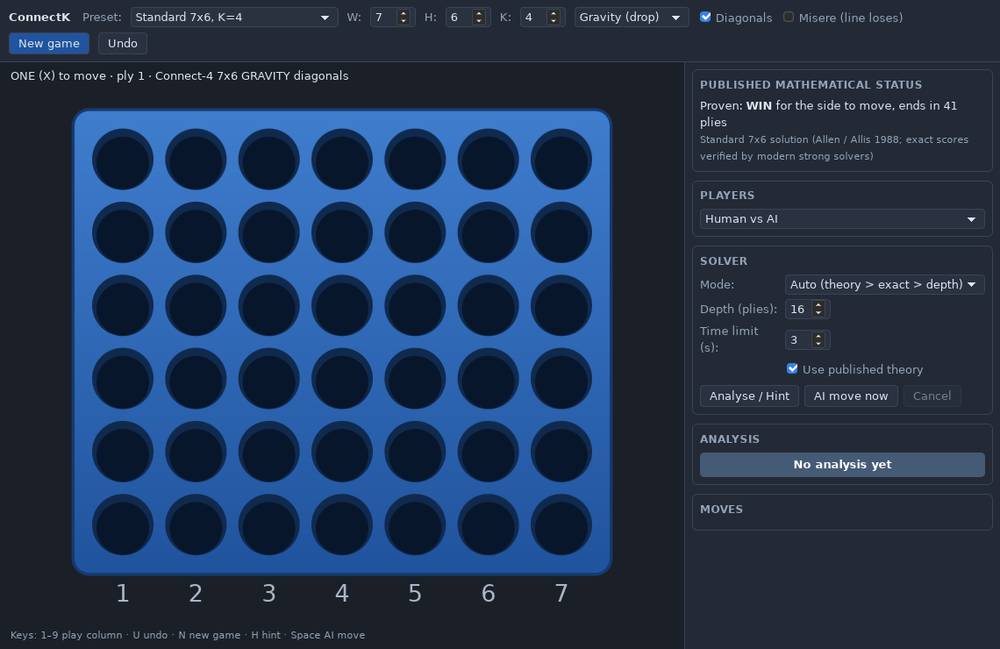

# ConnectK

A generic Connect-4/5/6-style game engine and solver in Rust. It aims to
play **provably perfectly** wherever that is computationally feasible, and
to be explicit whenever it cannot:

* **Mathematical results first** — published solved boards (Tromp/Allis,
  e.g. standard 7×6 is a first-player win on move 41) are answered from a
  theory database without search.
* **Exact search where feasible** — a bitboard negamax/PVS solver with a
  dual-bound transposition table, exact threat bounds, generalized
  claim-even, mirror symmetry, and resumable exact opening books.
* **Depth-limited play where no proof is available** — heuristic results
  are labelled `HEURISTIC_DEPTH_LIMITED`, never presented as proofs.
* If an exact search runs out of budget, the engine says
  `UNKNOWN_LIMIT_REACHED` and declines to recommend a move.

Rules are generic: arbitrary width and height, connect length `K`,
gravity or free placement, optional diagonal wins, and misère mode
(completing a line loses). The optimized exact solver covers gravity
games whose padded bitboard layout fits in one 64-bit word, with
standard (non-misère) play. Other rule
combinations use a fully generic exact solver.

## Build

The engine and CLI need only a stable Rust toolchain. On Arch Linux:

```bash
sudo pacman -S --needed rustup
rustup default stable
```

Then:

```bash
./build.sh          # release-build engine + CLI (rust/target/release/connectk)
./build.sh test     # run the test suite (36 tests, ~1 s)
./build.sh core     # engine crate only
./build.sh gui      # optional Tauri GUI (see below)
```

The release profile follows the Rust Performance Book's maximum-speed
configuration (fat LTO, one codegen unit, `panic = "abort"`, stripped),
and `rust/.cargo/config.toml` sets `target-cpu=native` for local builds.
Delete that config file if you build binaries for other machines. The
engine crate has **zero external dependencies**, so startup is a single
small native binary (about 0.6 MB; a no-work CLI invocation takes
~16 ms in the benchmark environment — see `docs/PERFORMANCE.md`).

## CLI

```bash
./run-cli.sh help
./run-cli.sh solve --width 5 --height 4                     # proven draw
./run-cli.sh solve --width 6 --height 4 --threads 4         # proven P2 win
./run-cli.sh solve --moves 4,4,3,3,7                        # 7x6 position, auto mode
./run-cli.sh solve --moves 4,4,3,3,7 --mode depth --depth 12
./run-cli.sh theory                                         # published 7x6 result
./run-cli.sh theory --width 8 --height 8
./run-cli.sh selfplay --width 4 --height 4 --mode exact     # perfect game transcript
```

Every result states its certainty:

| Certainty | Meaning |
|---|---|
| `PROVEN_EXACT` | Found by complete search; score and best move are exact. |
| `PROVEN_BY_THEORY` | Outcome from published research. The recommended move is proven only when the output says so (`move is proven optimal`). |
| `HEURISTIC_DEPTH_LIMITED` | Fixed-depth heuristic search. Not a proof. |
| `UNKNOWN_LIMIT_REACHED` | Budget exhausted; no move is recommended. |

Scores are from the side to move: positive means a forced win, and the
magnitude `cells − final_ply + 1` prefers faster wins and slower losses.
In `auto` mode the engine uses theory, attempts an exact proof when the
position looks tractable, and otherwise falls back to depth-limited
search (keeping a proven outcome from theory when one exists, with the
move honestly marked heuristic).

Exact options include `--time`, `--nodes`, `--threads` (parallel root
splitting), `--no-theory`, and `--book FILE`. (The GUI additionally
auto-loads matching books from `./books`; the CLI takes `--book`
explicitly.)

### Opening books

`bookgen` solves every canonical position up to a given ply with the
exact solver and writes them in the project's long-standing text format
(unchanged by the Rust port, so previously generated books still work):

```bash
./run-cli.sh bookgen --width 6 --height 4 --diagonals false --depth 12 \
    --out books/nodiag6x4-d12.book --threads 8 --per-pos-time 20000
```

Generation is resumable and flush-checkpointed: interrupting and
re-running the same command keeps completed entries. See
`books/README.md` for the inventory generated so far (book files
themselves are gitignored because they are regenerable solver output).

## GUI (optional)

The GUI is a Tauri 2 application: a small Rust backend over the same
engine crate, with a single-file HTML/canvas front end rendered by the
system WebKitGTK webview. In a Wayland session it is a native GTK/Wayland
window — no XWayland, no Electron, no bundled browser.



On Arch Linux, install the Tauri prerequisites once:

```bash
sudo pacman -S --needed webkit2gtk-4.1 base-devel openssl \
    appmenu-gtk-module libappindicator-gtk3 librsvg xdotool
./run-gui.sh        # builds on first run, then launches the window
```

Features: clickable board (keyboard `1`–`9` also play columns; `U` undo,
`N` new game, `H` hint, `Space` AI move), rule presets and custom rules,
Human vs Human / vs AI /
AI vs AI, published-theory panel, solver mode/depth/time controls, live
node counts with cancellation, certainty badge, principal variation, and
suggested-move and winning-line highlighting. Books in `./books` whose
names match the selected rules (`std{W}x{H}-d{D}.book`,
`nodiag{W}x{H}-d{D}.book`) are picked up automatically.

### Removing the GUI

The GUI lives in its own Cargo workspace and nothing depends on it:

```bash
rm -rf rust/gui run-gui.sh
./build.sh test     # engine + CLI unaffected
```

CI verifies this on every run.

## Performance

The Rust engine is node-for-node identical to the solver it replaced on
the benchmark positions used for validation (e.g. the hard opening
`1,3,7,1,2` solves in exactly 76,563,549 nodes with a 2^22-entry table),
while running as a small native binary with no runtime startup cost. On
the 2-core sandbox used for development it reaches ~1.6–2.0 M nodes/s on
Pons standard 7×6 benchmark sets; the depth-limited solver gained
principal-variation search in the Rust port (about 2× faster wall-clock
at depth 14 on the built-in test positions). Specialized 7×6-only
solvers are faster on desktop hardware; ConnectK trades some raw speed
for generic board sizes, K = 3–6, rule variants, theory, and books.
Details, methodology, and honest comparisons: `docs/PERFORMANCE.md`.

## Layout

```
rust/
  core/    engine crate (zero dependencies): bitboard model, exact /
           parallel / depth-limited solvers, evaluator, theory
           database, opening books, UI-facing session API
  cli/     command-line front end (solve, theory, selfplay, bookgen)
  gui/     optional Tauri app in its own workspace (delete freely)
books/     generated opening books (gitignored) + inventory README
docs/      THEORY.md (published results), PERFORMANCE.md (benchmarks)
```

Design notes: `DESIGN.md`. Published-theory coverage and sources:
`docs/THEORY.md`.

Benchmark and validation examples (run from `rust/`):

```bash
cargo run --release -p connectk-core --example bench -- <file> [n] [ms] [fast]
cargo run --release -p connectk-core --example depth_bench
cargo run --release -p connectk-core --example claim_fuzz -- [games] [seed]
```

## Provenance

All code is original work written for this project. Published *results*
(game values, benchmark positions) are facts and are cited in
`docs/THEORY.md`; no third-party solver code or data files are included.
